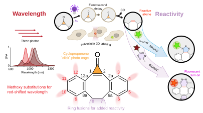

<h1 align="center">NORMA Molecular Inks</h1>

<p align="center"><strong>Non-linear Optical Recursive MApping</strong><br>
Spectrally tunable chemistry for optical writing of biomolecular information</p>

<p align="center">
  
</p>

## Overview

This repository accompanies the manuscript:

**Molecular Inks: Spectrally Tunable Chemistry for Three-Photon Writing in Cells**

N. Alfred Larsson, Andreas Torell, Kalliopi Tzavlaki, Kristina Jevdokimenko, Jan Ahrens, Oliver Prochnow, Luke R. Odell, Sinem K. Saka and Daniel Fürth.

NORMA is a family of photoactivatable cyclooctynes engineered for wavelength-selective, spatially resolved and iterative covalent labeling of biomolecules. Methoxy substitution tunes the activation spectrum, while ring-fusion architecture modulates ligation chemistry toward azides and tetrazines. Patterned one-photon illumination enables molecular writing in fixed cells, and nonlinear three-photon excitation extends the approach to three-dimensional subcellular volumes.

The repository is intended to support reproducibility of the quantitative analyses and figures presented in the manuscript.

## Repository structure

```text
NORMA_Molecular_inks/
├── data/                         # Analysis input data
├── figures/                      # Figure files and README graphics
├── R/                            # R analysis scripts
├── xray_crystallography/          # Crystallographic materials
├── NORMA_Molecular_inks.Rproj      # RStudio project
└── README.md                     # Repository documentation
```

## Getting started

### Requirements

- [R](https://www.r-project.org/)
- [RStudio](https://posit.co/download/rstudio-desktop/) (recommended)
- [RStan](https://mc-stan.org/rstan/) for Bayesian modeling, together with a compatible C++ toolchain

The manuscript reports R 4.2.2 for the single-cell statistical analysis and RStan 2.32.2 for Bayesian modeling of power-dependent photolabeling. Additional package dependencies are specified by the individual scripts, where applicable.

### Running the analyses

1. Clone or download this repository using the GitHub **Code** menu.
2. Open `NORMA_Molecular_inks.Rproj` in RStudio.
3. Inspect the relevant analysis script in [`R/`](R/) and install any required R packages.
4. Run the script from the repository root, retaining the supplied directory structure so that relative data paths can be resolved.
5. Compare the resulting quantitative outputs with the corresponding manuscript figure or table.

To inspect the available analysis scripts from an R session opened at the repository root:

```r
list.files("R", pattern = "\\.[Rr]$", recursive = TRUE,
           full.names = TRUE)
```

Record the R and package versions used for a reproduction run with:

```r
sessionInfo()
```

## Data and crystallography

Analysis input files are organized under [`data/`](data/). Crystallographic materials are organized separately under [`xray_crystallography/`](xray_crystallography/), including materials associated with the structural characterization described in the manuscript.

For experimental protocols, acquisition parameters, statistical models, replicate definitions and interpretation of the analyses, refer to the manuscript and its Supplementary Information.

## Citation

If you use the code or methods associated with this work, please cite the accompanying manuscript:

> Larsson, N. A., Torell, A., Tzavlaki, K., Jevdokimenko, K., Ahrens, J., Prochnow, O., Odell, L. R., Saka, S. K. & Fürth, D. Molecular Inks: Spectrally Tunable Chemistry for Three-Photon Writing in Cells. Manuscript (2026).

<!-- Replace this provisional citation with the published reference and DOI when available. -->

## Contact

**Fürth Lab** — Department of Immunology, Genetics and Pathology, Uppsala University; Science for Life Laboratory (SciLifeLab), Uppsala, Sweden.

Correspondence: [furth@scilifelab.uu.se](mailto:furth@scilifelab.uu.se)

---

<p align="center">Fürth Lab · Uppsala University · SciLifeLab</p>
